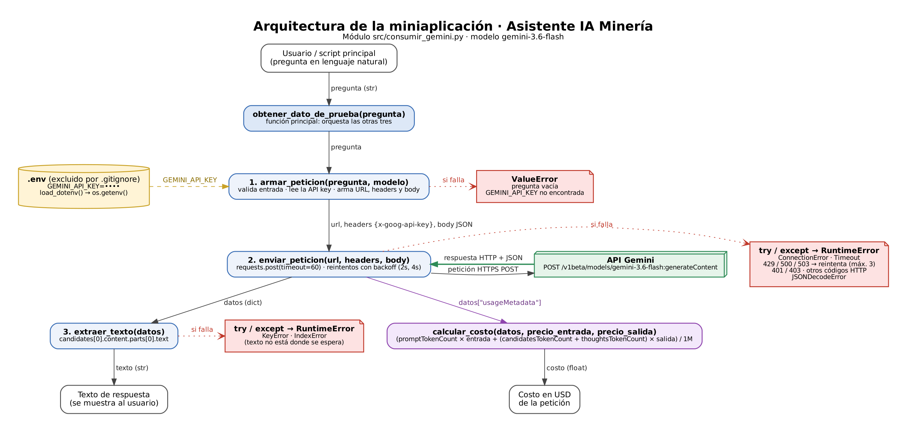

# Decisión de arquitectura: elección de modelo

**Proyecto:** Asistente IA para seguridad en minería (miniaplicación del Módulo 1)

## Modelo elegido

**`gemini-3.6-flash`** (Google Gemini API)

## Diagrama de arquitectura

El modelo se usa en `armar_peticion` (parámetro `modelo`, por defecto `MODELO = "gemini-3.6-flash"` en `src/consumir_gemini.py`). El costo de cada petición se calcula con `calcular_costo` a partir de `usageMetadata`.

## Comparación de candidatos

Datos medidos con `src/comparar_modelos.py`. Las respuestas completas están en [`respuestas_comparacion.md`](respuestas_comparacion.md).

| Criterio | gemini-3.6-flash | gemini-3.5-flash-lite |
|---|---|---|
| Costo por 1M tokens de entrada | USD 0,75 (USD 1,50 desde el 1/1/2027) | USD 0,30 |
| Costo por 1M tokens de salida (incluye tokens de pensamiento) | USD 3,75 (USD 7,50 desde el 1/1/2027) | USD 2,50 |
| Tokens de pensamiento en una pregunta corta | ~217 | 0 (no razona antes de responder) |
| Costo de una petición corta de prueba | ~USD 0,00085 | ~USD 0,000036 |
| Latencia promedio observada (4 mediciones por corrida) | 3,50 s · 3,65 s · 3,64 s | 1,72 s · 1,70 s · 2,20 s |
| Cuota del plan gratuito | 5 peticiones/minuto y 20 peticiones/día | No se alcanzó el límite en las pruebas |
| Errores 503 (servicio saturado) durante las pruebas | Varios, en ambas corridas | Ninguno |
| Calidad para mi caso (3 preguntas de seguridad minera) | Muy buena: más específica y técnica para faena | Buena, pero con caracteres de otros idiomas en 2 respuestas |

Precios obtenidos de la página oficial de precios de Gemini API (plan pagado, nivel estándar), consultada el 20/10/2026.

### Observaciones de las mediciones

- **Los tokens de pensamiento dominan el costo de 3.6-flash.** Para responder 8 tokens el modelo generó ~217 tokens de razonamiento interno, que se cobran como salida. Por eso una petición corta cuesta ~24 veces más que con flash-lite. Sin contar `thoughtsTokenCount`, el cálculo de costo saldría muy subestimado.
- **Latencia atípica en la primera petición.** En una corrida inicial, la primera llamada a 3.6-flash tardó 24,9 s y las siguientes entre 3 y 7,5 s. Por eso se promedian varias mediciones y no se usa una sola.
- **Errores transitorios del proveedor.** Con 3.6-flash aparecieron errores 503 (servicio saturado) en las dos corridas; con flash-lite, ninguno. Esto llevó a agregar reintentos con espera creciente en `enviar_peticion`.
- **Límite por minuto.** En la segunda corrida, una pregunta de 3.6-flash falló con error 429 por el límite de 5 peticiones/minuto del plan gratuito: las mediciones de latencia más los reintentos por 503 lo agotaron. Se completó después con una petición aislada.

### Evaluación de calidad

**Pregunta 1: "¿Qué pasos debo seguir antes de intervenir una correa transportadora?"**

- *gemini-3.6-flash:* en las dos corridas, respuesta muy completa y específica para minería. Menciona el CCM, el bloqueo del contrapeso (take-up), el sistema antirretorno (backstop) en correas inclinadas, la prueba de energía cero (tryout) y advertencias clave, como que el pull cord y la botonera son dispositivos de control y no de aislamiento. En la segunda corrida usó terminología chilena (AST, charla de 5 minutos) y cerró con el derecho a detener un trabajo inseguro. Detalles a mejorar: en la primera corrida usó siglas de Perú (PETAR, IPERC; en la segunda, SSOMA), una fórmula en formato LaTeX que no se ve bien como texto plano y algunas erratas ("señores o trócolas").
- *gemini-3.5-flash-lite:* respuesta correcta y bien estructurada, pero menos específica (no menciona el antirretorno ni la diferencia entre dispositivos de control y de aislamiento). En la primera corrida se colaron caracteres en chino en medio del texto ("el motor del 输送机"), una falla visible para un usuario final.

**Pregunta 2: "¿Qué es el bloqueo y etiquetado de energías y cuándo se aplica?"**

- *gemini-3.6-flash:* explicación clara de bloqueo y etiquetado (qué indica la etiqueta: quién, fecha y motivo), los 7 tipos de energía y los 6 pasos hasta la energía cero. En "cuándo se aplica" agrega un caso que flash-lite no menciona: cada vez que un trabajador debe introducir una parte del cuerpo en la zona de operación de la máquina. Nivel de detalle similar al de flash-lite y también genérico (cita OSHA; usa "fajas transportadoras", término de Perú). Nota: esta petición se hizo desde PowerShell, que eliminó las tildes de la pregunta ("Qu es... energas... cundo"), y aun así el modelo la interpretó correctamente.
- *gemini-3.5-flash-lite:* explicación clara de bloqueo y etiquetado, tipos de energía y los 6 pasos de un procedimiento LOTO. Correcta, pero genérica (no está orientada a minería). En la segunda corrida volvió a aparecer texto en otro alfabeto ("Aislamಿತು", caracteres en canarés).

**Pregunta 3: "¿Qué elementos de protección personal necesito para trabajar en altura?"**

- *gemini-3.6-flash:* respuesta más técnica: eslinga en "Y" para mantener conexión 100 % del tiempo, anclajes de 22 kN por persona, cálculo de la distancia libre de caída, inspección previa del equipo y plan de rescate por síndrome del arnés. Pequeñas erratas de redacción ("Debe distribuye").
- *gemini-3.5-flash-lite:* lista completa y correcta (arnés, eslinga con absorbedor, línea de vida, casco con barbiquejo) y menciona el síndrome del arnés. Algo menos detallada en lo técnico (no menciona la distancia libre de caída ni la conexión permanente).

**Balance de calidad:** en las preguntas prácticas de faena (1 y 3), las respuestas de 3.6-flash fueron claramente más técnicas y específicas; en la pregunta conceptual (2), ambos modelos rindieron de forma parecida. Flash-lite fue correcto, pero en dos de seis respuestas mezcló caracteres de otros idiomas, un problema de confiabilidad que no apareció en 3.6-flash. Ambos se basan en normas internacionales (ANSI/OSHA) y no en la normativa chilena.

Ninguno de los dos modelos citó normativa chilena (por ejemplo, el DS 132). Esto confirma que la precisión respecto a documentos propios tendrá que venir del flujo RAG del Módulo 2, no del conocimiento general del modelo.

## Justificación

Elegí **gemini-3.6-flash** porque mi miniaplicación responde preguntas sobre **seguridad en faena**, y en ese contexto una respuesta incompleta o imprecisa puede tener consecuencias graves. El criterio que más pesó fue la **calidad de la respuesta para mi caso**: 3.6-flash entregó respuestas más específicas para minería e incluyó advertencias críticas (por ejemplo, que el pull cord no aísla energía) que flash-lite no mencionó.

El costo extra se justifica: aunque cada petición cuesta bastante más, sigue siendo menos de una décima de centavo de dólar, y el volumen esperado de un asistente de consulta interno es bajo. La latencia de ~3,6 s es aceptable para un usuario que consulta un procedimiento antes de una tarea, porque no necesita una respuesta instantánea.

**Riesgos de esta elección y cómo los manejo:**

- *Cuota gratuita de 5 peticiones/minuto y 20 peticiones/día:* limita las pruebas durante el desarrollo. Mitigación: hacer pruebas acotadas, y como `armar_peticion` recibe el modelo como parámetro, puedo usar flash-lite temporalmente en pruebas masivas sin cambiar el resto del código.
- *Aumento de precio desde el 1/1/2027 (el doble):* hay que volver a evaluar esta decisión antes de esa fecha.
- *Errores 503 por saturación (más frecuentes que en flash-lite):* mitigados con reintentos y backoff exponencial en `enviar_peticion`.

## Alternativa descartada y por qué

Descarté **gemini-3.5-flash-lite**. Es aproximadamente **24 veces más barato por petición** y responde en la **mitad de tiempo** (~1,7 s), porque no usa tokens de pensamiento. Sería la mejor opción para una aplicación de alto volumen donde la velocidad es lo principal. Además, fue más estable: no tuvo errores 503. Pero sus respuestas fueron más genéricas para el contexto minero, y en dos de seis respuestas apareció texto en otros alfabetos (chino y canarés). En un asistente de seguridad, la confiabilidad y el detalle pesan más que el ahorro, así que flash-lite no se ajusta a la prioridad de mi caso.